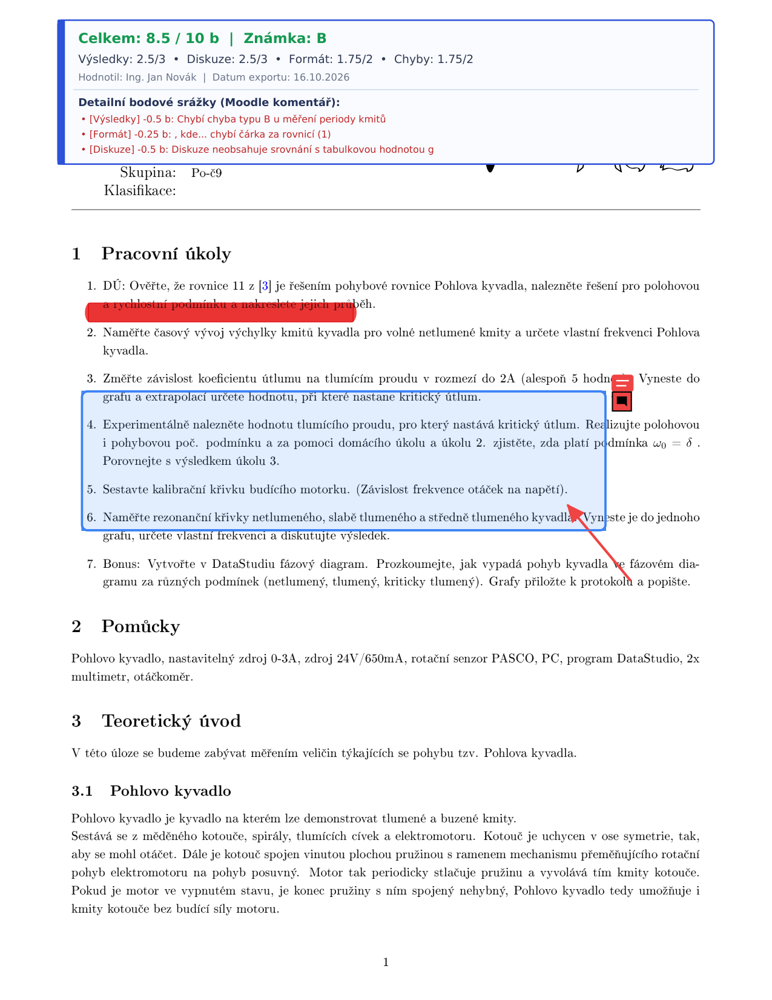

# Praktika – Systém pro hodnocení laboratorních protokolů

[](https://www.python.org/)
[](https://fastapi.tiangolo.com/)
[](https://pymupdf.readthedocs.io/)
[](https://ai.google.dev/)
[](https://github.com/TheLittleRock/Praktika/pkgs/container/praktika)
[](https://thelittlerock.github.io/Praktika/)
[](https://opensource.org/licenses/MIT)

**Praktika** je webová aplikace pro vyučující a asistenty fyzikálních praktik, určená k efektivní, objektivní a detailní revizi studentských protokolů v PDF formátu.

Nabízí interaktivní korekční studio s vektorovými kreslícími nástroji (zvýrazňovač, pero, tvary, šipky, poznámky kompatibilní s Adobe Acrobatem), asistenci jazykového modelu **Google Gemini 2.5 Flash** s českými fyzikálními rubrikami a export hodnocení připravený pro LMS Moodle.

📖 **Kompletní dokumentace projektu:** [https://thelittlerock.github.io/Praktika/](https://thelittlerock.github.io/Praktika/)

---

## 📸 Ukázka rozhraní

### 1. Korekční PDF Studio s integrovaným AI Asistentem
Interaktivní revize protokolů s podporou kreslení, poznámkových lístků a postranním panelem asistenta:



---

### 2. Exportované PDF s Moodle hlavičkou a vektorovými anotacemi
Vizuální výstup s pevnou typografií (DejaVu Sans), sytými rámečky, šipkami a Acrobat poznámkovými bublinami:



---

### 3. Analytická pipeline Google Gemini
Architektura zpracování dokumentu od extrakce po aplikaci srážek:


---

## 🚀 Rychlá instalace

### Varianta A: Spuštění přes Docker & Portainer (Doporučeno)

Předpřipravené kontejnery jsou automaticky publikovány do GitHub Container Registry (GHCR).

Vytvořte soubor `docker-compose.yml`:

```yaml
version: '3.8'

services:
  praktika:
    image: ghcr.io/thelittlerock/praktika:latest
    container_name: praktika
    restart: unless-stopped
    ports:
      - "8000:8000"
    volumes:
      - praktika_data:/app/data
    environment:
      - PRAKTIKA_DATA_DIR=/app/data
      - PRAKTIKA_SECRET_KEY=zvolte-tajny-nahodny-klic
      - GEMINI_API_KEY=vas-volitelny-gemini-klic

volumes:
  praktika_data:
    name: praktika_data
```

Spusťte kontejner:
```bash
docker compose up -d
```

Aplikace bude dostupná na adrese `http://localhost:8000`.

> [!TIP]
> Pro testování nejnovější vývojové verze nastavte `image: ghcr.io/thelittlerock/praktika:dev`.

---

### Varianta B: Lokální instalace (Python 3.10+)

```bash
# 1. Klonování repozitáře
git clone https://github.com/TheLittleRock/Praktika.git
cd Praktika

# 2. Vytvoření virtuálního prostředí
python3 -m venv venv
source venv/bin/activate

# 3. Instalace závislostí
pip install -r requirements.txt

# 4. Spuštění serveru
uvicorn app.main:app --host 0.0.0.0 --port 8000 --reload
```

---

## 🌿 Struktura větví repozitáře

Projekt dodržuje standardní větvení:

- **`main`**: Stabilní produkční verze. Každý push do `main` automaticky publikuje Docker image `:latest` a aktualizuje GitHub Pages dokumentaci.
- **`dev`**: Aktivní vývojová větev. Všechny nové funkce a opravy směřují do `dev` a generují Docker image `:dev`. Po otestování je větev sloučena do `main`.

---

## 📄 Licence a historie změn

Projekt je licencován pod otevřenou licencí [MIT](LICENSE).  
Přehled všech novinek a úprav naleznete v **[Changelogu](docs/changelog.md)**.
