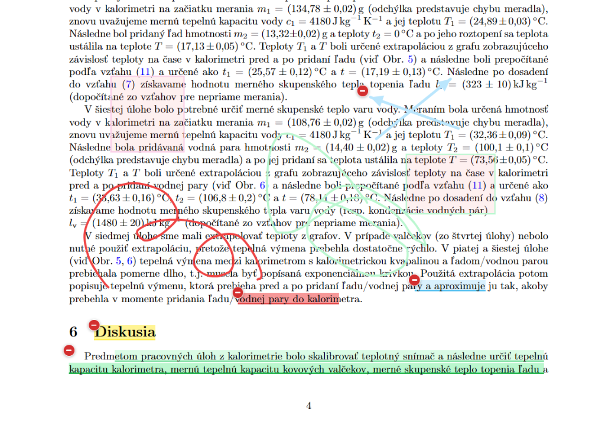
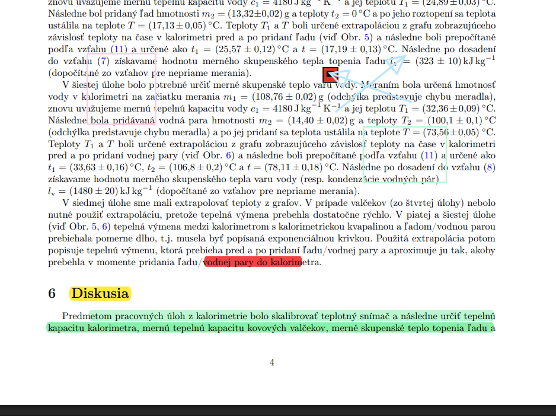
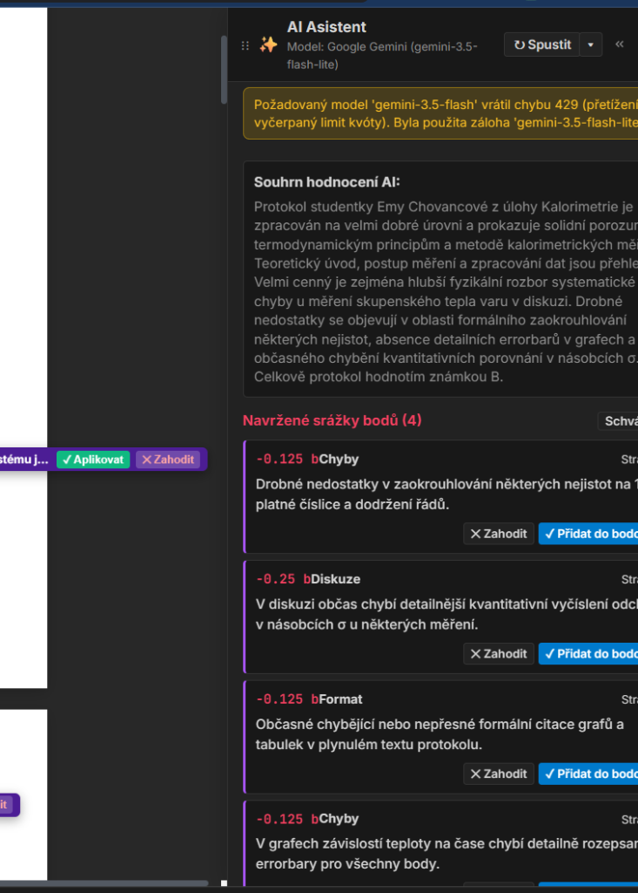
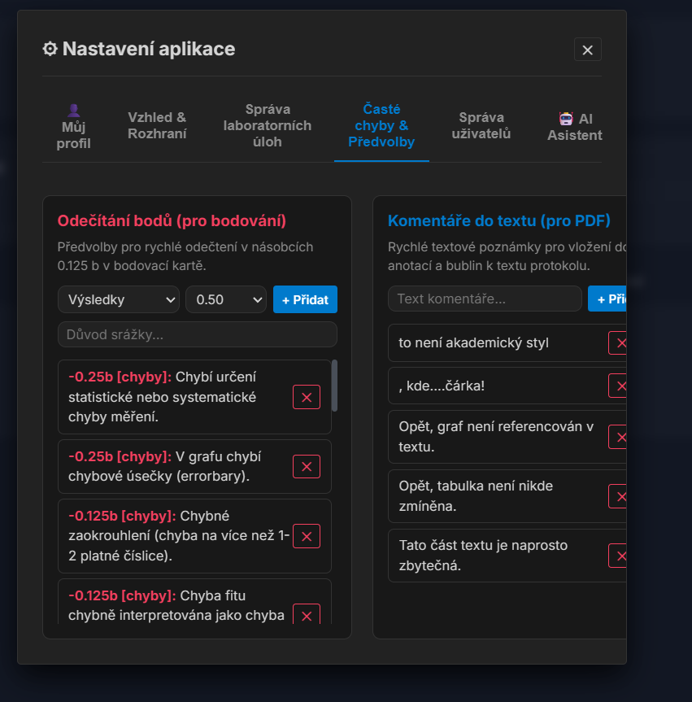
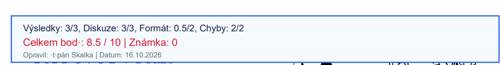

# 🔬 Praktika – Systém pro správu a hodnocení fyzikálních protokolů

[](https://www.python.org/)
[](https://fastapi.tiangolo.com/)
[](https://pymupdf.readthedocs.io/)
[](https://ai.google.dev/)
[](https://thelittlerock.github.io/Praktika/)
[](https://opensource.org/licenses/MIT)

Moderní webová aplikace určená pro vyučující, garanty a asistenty fyzikálních praktik (FPRA1, FPRA2, ZFM2). Umožňuje rychlé odevzdávání, hromadnou správu, interaktivní opravování v PDF s exhaustivní asistencí umělé inteligence (Google Gemini), přesné bodování s předvolbami srážek a export finálních opravených protokolů.

📖 **Živá dokumentace a uživatelská příručka:** [https://thelittlerock.github.io/Praktika/](https://thelittlerock.github.io/Praktika/)

---

## 📸 Ukázky z aplikace (Screenshots)

### 1. Interaktivní PDF Annotation Studio
Vizuální korekce protokolů přímo v prohlížeči. Podpora zvýrazňování, kreslení perem, tvarů (obdélníky, šipky), psacího stroje a Acrobat-style komentářových lístků s přímou vazbou na bodovací srážky.



---

### 2. Inteligentní AI Asistent (Google Gemini)
Exhaustivní kontrola celého protokolu: syntaktická kontrola vzorců (např. povinná čárka před `", kde"`), typografie jednotek, kontrola errorbarů v grafech a automatické souhrnné rozbory pro jednotlivé sekce (*Úvod*, *Metodika*, *Výsledky*, *Diskuze*, *Závěr*). Schvalování a zamítání funguje okamžitě na plátně i v bočním panelu s trvalou persistencí.



---

### 3. Přehled protokolů a hromadné akce
Tabulka protokolů s filtry (semestr, termín, úloha, stav, *Moje protokoly*), možností přiřazování asistentů a hromadnými operacemi (hromadná úprava termínů/úloh a bezpečné hromadné mazání).



---

### 4. Správa databáze, zálohy a diagnostika
Administrátorské rozhraní pro správu SQLite databáze: okamžité ruční zálohování, obnova jedním kliknutím, automatická denní rotace 7 záloh, kontrola integrity databáze a živé statistiky.



---

### 5. Exportované PDF s diakritikou a rozpadem srážek
Vypalování anotací a hlavičkového razítka hodnocení s využitím TrueType fontů (DejaVuSans pro bezchybnou češtinu/slovenštinu), přesným písmenem známky (A–F) a detailním přehledem bodových srážek.



---

## 🚀 Klíčové vlastnosti

- **🎨 Pokročilé PDF Studio:**
  - Plynulý HiDPI rendering bez problikávání.
  - Oddělená a plynulá kalibrace zoomu pro touchpad i `Ctrl + kolečko` myši s udržením centrování stránky.
  - Nastavitelné boční panely (libovolné zvětšování/zmenšování tažením za okraj, dokování vlevo/vpravo či plovoucí okno).
  - Plovoucí indikátor automatického ukládání (autosave každých 1.5 s bez překrývání tlačítek).
- **🤖 Gemini AI Asistent:**
  - Podpora modelů `gemini-3.5-flash-lite`, `gemini-3.5-flash`, `gemini-3.8-flash` s automatickým fallbackem při přetížení kvóty.
  - Generování hodnotících rubrik přímo z oficiálních návodů k laboratorním úlohám.
  - Zákaz prázdných pochval – asistent se soustředí výhradně na reálné chyby a místa k nápravě.
- **📊 Komplexní bodovací systém:**
  - Čtyři oficiální kategorie: **Výsledky** (3 b), **Diskuze** (3 b), **Formát a styl** (2 b), **Chyby a nejistoty** (2 b).
  - Srážky v násobcích 0.125 b s předvolbami nejčastějších chyb.
  - Automatický převod na známku A–F s možností manuálního přepsání.
- **📁 Hromadný import & export:**
  - Hromadné nahrávání PDF s automatickou extrakcí jména studenta a nativních anotací.
  - Hromadný export opravených PDF a bodovacích souborů do ZIP archivu.
  - Export souhrnného CSV pro studijní systém (SIS / STAG).

---

## 🛠️ Instalace a spuštění

### 1. Požadavky
- Python 3.10 nebo novější
- SQLite 3
- Běžné TrueType fonty (pro Linux např. `fonts-dejavu-core`)

### 2. Klonování repozitáře
```bash
git clone https://github.com/TheLittleRock/Praktika.git
cd Praktika
```

### 3. Vytvoření virtuálního prostředí a instalace
```bash
python3 -m venv venv
source venv/bin/activate
pip install --upgrade pip
pip install -r requirements.txt
```

### 4. Spuštění serveru
```bash
uvicorn app.main:app --host 0.0.0.0 --port 8000 --reload
```

Aplikace je nyní dostupná v prohlížeči na adrese:  
👉 **`http://localhost:8000`**

### 5. Výchozí přihlašovací údaje
| Role | Uživatelské jméno | Heslo |
|---|---|---|
| **Administrátor** | `admin` | `admin123` |
| **Asistent** | `asistent` | `asistent123` |

*(Hesla i uživatele lze libovolně měnit v záložce Nastavení).*

---

## 📂 Struktura projektu

```text
Praktika/
├── app/
│   ├── config.py           # Konfigurace cest, JWT a prostředí
│   ├── database.py         # Inicializace SQLite, migrace a správa záloh
│   ├── auth.py             # Autentizace, hashování hesel a JWT tokeny
│   ├── models.py           # Pydantic schémata a DTO modely
│   ├── pdf_service.py      # Práce s PDF přes PyMuPDF (anotace, fonty, export)
│   ├── ai_service.py       # Integrace Google Gemini a metodika fyzikálního praktika
│   ├── main.py             # FastAPI aplikace a REST API endpointy
│   ├── templates/
│   │   └── index.html      # Hlavní single-page šablona aplikace
│   └── static/
│       ├── css/
│       │   └── app.css     # CSS styly a moderní design systém
│       └── js/
│           ├── app.js          # Hlavní frontend logika a router
│           ├── pdf_viewer.js   # PDF.js plátno, kreslení a anotační studio
│           └── grading.js      # Bodovací engine a výpočet známek
├── docs/                   # Podklady a HTML dokumentace pro GitHub Pages
│   ├── index.html          # Interaktivní uživatelská a technická příručka
│   └── images/             # Screenshoty a schémata pro dokumentaci
├── tests/                  # Integrační a regresní testovací sady
├── data/                   # SQLite databáze a zálohy (ignorováno gitem)
├── uploads/                # Nahrané zdrojové protokoly (ignorováno gitem)
├── exports/                # Vygenerovaná opravená PDF (ignorováno gitem)
├── requirements.txt        # Seznam Python závislostí
└── README.md               # Úvodní dokumentace projektu
```

---

## 🧪 Spuštění testů

Projekt obsahuje komplexní sadu integračních testů pokrývajících všechny funkce:

```bash
PYTHONPATH=. ./venv/bin/python tests/test_full_suite.py
PYTHONPATH=. ./venv/bin/python tests/test_v2_7_features.py
PYTHONPATH=. ./venv/bin/python tests/test_v2_8_features.py
```

---

## 📄 Licence
Projekt je licencován pod licencí [MIT](LICENSE).
