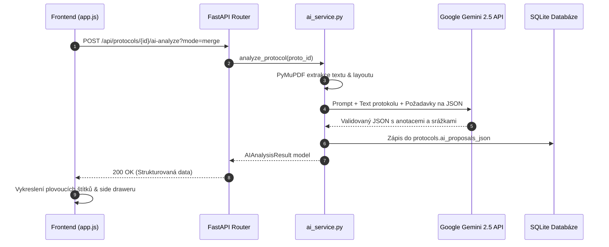

# AI Analytická pipeline

Modul `app/ai_service.py` zajišťuje integraci s modely Google Gemini a zpracovává surový text protokolu do strukturovaných doporučení.

---

## 🔄 Analytický cyklus

---

## 🎯 Prompt Inženýrství a kalibrace

Systémový prompt je navržen tak, aby minimalizoval halucinace a zaměřil se výhradně na reálné nedostatky:

- **Strukturovaný JSON výstup**: Model vrací data striktně odpovídající definovanému Pydantic schématu `AIAnalysisResult`.
- **Lokalizace chyb**: Pro každou nalezenou chybu vrací model řetězec `search_text` a číslo stránky `page`. Backend následně pomocí PyMuPDF fulltextového hledání dohledá přesné souřadnice ohraničujícího obdélníku `[x0, y0, x1, y1]`, což umožňuje přesné umístění štítku přímo nad danou větu nebo vzorec.

---

## 🔀 Strategie slučování (Merge vs. Replace)

Vyučující má možnost spustit AI analýzu opakovaně:

- **Mode: `merge` (Výchozí)**: Pokud asistent nalezne nové nedostatky, připojí je ke stávajícím dosud neschváleným návrhům, přičemž automaticky filtruje duplicity na základě kategorie a textu chyby.
- **Mode: `replace`**: Kompletně zresetuje stávající AI návrhy a vygeneruje zcela novou analýzu.

---

## ⚡ Atomické akce nad návrhy

Endpoint `/api/protocols/{proto_id}/ai-proposals/action` podporuje okamžité zpracování jednotlivých návrhů:

- `approve_annotation`: Přenese návrh do ostré tabulky `annotations`, přiřadí mu výchozí červenou barvu `#ef4444` a odstraní jej ze seznamu čekajících návrhů.
- `reject_annotation`: Zahodí návrh z databáze i plátna.
- `approve_deduction`: Přidá bodovou srážku do oficiálního hodnocení protokolu.
- `approve_all_annotations` / `approve_all_deductions`: Hromadné schválení všech položek naráz.
