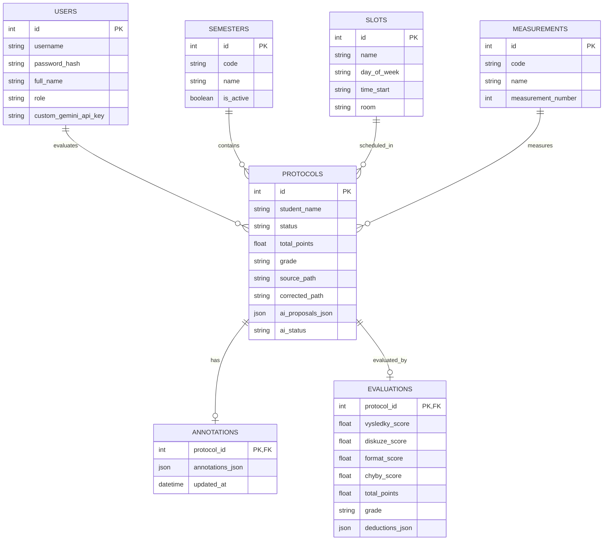

# Backend a datové modely

Backend je postaven na moderním asynchronním frameworku **FastAPI** v jazyce Python 3.10+.

---

## 💾 Databázové schéma (SQLite)

Databáze je navržena pro relační integritu s využitím formátu JSON pro flexibilní data (anotace, návrhy AI):



---

## 📦 Pydantic modely (DTO)

### Datová struktura anotace (`AnnotationItem`)
Každá grafická značka v dokumentu má deterministickou strukturu:

```python
class AnnotationItem(BaseModel):
    id: str                                    # Unikátní identifikátor (např. annot_14_173000)
    page: int                                  # Číslo stránky (1-indexed)
    type: str                                  # 'highlight' | 'strikeout' | 'note' | 'pen' | 'rect' | 'arrow' | 'text_direct'
    rect: Optional[List[float]] = None         # [x0, y0, x1, y1] v PDF souřadnicích
    rects: Optional[List[List[float]]] = None  # Seznam obdélníků pro víceřádkové zvýraznění
    point: Optional[List[float]] = None        # [x, y] pro poznámky a vepsaný text
    p1: Optional[List[float]] = None           # [x, y] počáteční bod šipky
    p2: Optional[List[float]] = None           # [x, y] koncový bod šipky
    strokes: Optional[List[List[List[float]]]] # Souřadnice tahů pera
    content: Optional[str] = ""                # Textový komentář
    author: Optional[str] = "Vyučující"        # Autor poznámky
    color: Optional[str] = "#ef4444"           # Hexadecimální barva
    width: Optional[float] = 2.0               # Tloušťka čáry
    created_at: Optional[str] = None
```

### Datová struktura srážky (`DeductionItem`)
```python
class DeductionItem(BaseModel):
    category: str                              # 'vysledky' | 'diskuze' | 'format' | 'chyby'
    pts: float                                 # Počet bodů ke stržení (např. 0.25)
    reason: str                                # Odůvodnění pro studenta
    page: Optional[int] = None
```

---

## 🔒 Bezpečnost a autentizace

- **Hashování hesel**: Využívá knihovnu `passlib` s algoritmem **bcrypt** a generováním náhodné soli.
- **Session management**: Autentizační tokeny jsou podepisovány HMAC-SHA256 (JWT) a ukládány v `HttpOnly` cookies s atributem `SameSite=Lax`.
- **RBAC (Role-Based Access Control)**:
    - `admin`: Plný přístup ke všem protokolům, správě semestrů, termínů, uživatelů, zálohám SQLite a diagnostice.
    - `evaluator` (cvičící): Přístup k přiděleným protokolům, korekčnímu studiu, vlastnímu API klíči a osobním předvolbám.
