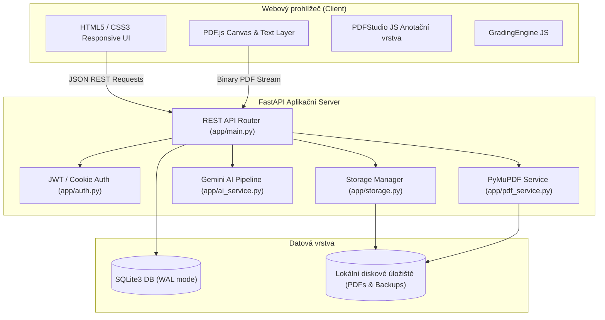

# Architektura a struktura projektu

Tato sekce dokumentace je určena vývojářům a systémovým integrátorům, kteří chtějí porozumět vnitřnímu fungování platformy Praktika nebo ji dále rozšiřovat.

---

## 🏛 Celková architektura

Aplikace je navržena jako lehká, vysoce výkonná monolitická webová aplikace využívající moderní Python stack:



---

## 📂 Struktura adresářů

```text
Praktika/
├── app/                        # Zdrojový kód aplikace
│   ├── main.py                 # FastAPI aplikace, routy, lifecycle události
│   ├── models.py               # Pydantic schémata a DTO modely
│   ├── database.py             # SQLite inicializace, migrace a správa záloh
│   ├── auth.py                 # Ověřování uživatelů, hashování hesel, JWT tokeny
│   ├── config.py               # Konfigurace aplikace a načítání proměnných prostředí
│   ├── storage.py              # Disková správa nahraných a exportovaných souborů
│   ├── pdf_service.py          # PyMuPDF jádro pro čtení a zápis PDF anotací
│   ├── ai_service.py           # Gemini 2.5 integrace, prompt inženýrství, merge návrhů
│   ├── templates/              # Jinja2 HTML šablony
│   │   ├── index.html          # Hlavní jednostránková aplikace (SPA)
│   │   └── student_view.html   # Studentský náhled s živým Studio renderingem a responzivním rozvržením
│   └── static/                 # Statické soubory
│       ├── css/                # Styly aplikace (app.css)
│       └── js/                 # Klientská logika (app.js, pdf_viewer.js, grading.js)
├── docs/                       # Zdrojové soubory MkDocs dokumentace
│   ├── guide/                  # Uživatelská příručka
│   ├── architecture/           # Technická dokumentace architektury
│   ├── installation/           # Instalační návody
│   └── images/                 # Diagramy a screenshoty
├── .github/
│   └── workflows/              # Automatizace GitHub Actions
│       ├── deploy-docs.yml     # Automatický build a nasazení dokumentace na gh-pages
│       └── docker-publish.yml  # Sestavení a publikování Docker obrazů na GHCR
├── Dockerfile                  # Produkční multi-arch kontejner
├── docker-compose.yml          # Konfigurace pro Portainer a Docker Compose
├── mkdocs.yml                  # Konfigurace Material for MkDocs
├── requirements.txt            # Python závislosti
└── README.md                   # Reprezentativní přehled projektu
```

---

## ⚡ Principy návrhu

1. **Minimální závislosti na frontendu**: Aplikace záměrně nepoužívá těžké frontendové frameworky (React, Angular). Celý frontend je realizován v čistém moderním Vanilla JavaScriptu s přímou DOM manipulací a vysokou rychlostí odezvy i na slabších zařízeních.
2. **Přesné vektorové PDF manipulace**: Pro veškerou práci s PDF soubory na serveru se používá C-binding knihovna **PyMuPDF (fitz)**, která zaručuje bleskovou rychlost a přesné dodržování PDF standardů (Acrobat anotace).
3. **Deterministická perzistence**: Každá změna anotace je okamžitě verzována a asynchronně ukládána do databáze, čímž je vyloučena ztráta dat při náhodném obnovení stránky nebo výpadku spojení.
