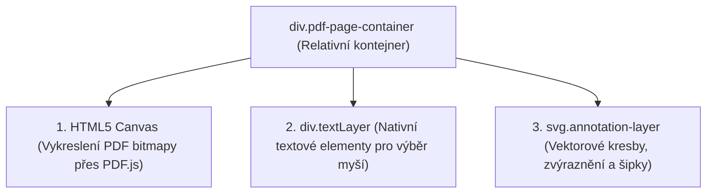

# PDF a grafické renderovací jádro

Práce s PDF dokumenty probíhá ve dvou nezávislých, avšak dokonale synchronizovaných vrstvách: **klientské interaktivní vrstvě (PDF.js + SVG)** a **serverové exportní vrstvě (PyMuPDF)**.

---

## 🖥 Klientská vrstva (Browser)

V prohlížeči je každá strana PDF dokumentu reprezentována kontejnerem se třemi na sobě položenými vrstvami:



1. **Canvas Layer**: Rychlé vykreslení stránek PDF dokumentu při daném měřítku `scale`.
2. **Text Layer**: Průhledné DOM prvky obsahující textové řetězce z PDF. Umožňuje nativní označení textu pro zvýrazňovač a přeškrtnutí.
3. **SVG Annotation Layer**: Zajišťuje ostré vykreslení uživatelských kreseb, tahů pera, rámečků, šipek a štítků AI návrhů nezávisle na rozlišení monitoru.

---

## 🖨 Serverová vrstva (PyMuPDF)

Při dokončení a exportu protokolu vygeneruje modul `app/pdf_service.py` finální PDF soubor přímo ze souřadnic uložených v databázi.

### Vektorové vykreslování tvarů
Místo spoléhání na nestandardní chování různých PDF prohlížečů vykresluje server tvary přímo do grafického streamu stránky:

- **Zvýraznění textu**:
  ```python
  page.draw_rect(fr, color=color_rgb, fill=color_rgb, fill_opacity=0.32, width=0.75, radius=0.08)
  ```
- **Rámečky s výplní**:
  ```python
  page.draw_rect(r, color=color_rgb, fill=color_rgb, fill_opacity=0.15, width=1.8, radius=0.04)
  ```
- **Směrové šipky**:
  Ostrá čára spojená s plně vyplněným polygonem hrotu šipky:
  ```python
  shape.draw_line(pt1, pt2)
  shape.draw_polyline([Point(h1_x, h1_y), pt2, Point(h2_x, h2_y), Point(h1_x, h1_y)])
  shape.finish(color=color_rgb, fill=color_rgb, width=1.0)
  shape.commit()
  ```
- **Acrobat-style poznámková bublina**:
  Vektorově vykreslený piktogram bubliny s bílými řádky textu uvnitř, provázaný se standardní PDF textovou anotací typu `Comment`.

---

## 🔡 Typografie a podpora diakritiky

Pro zajištění bezchybné sazby českých a slovenských znaků (např. *ě, š, č, ř, ž, ý, á, í, é, ů, ú*) využívá exportní modul písmo **DejaVu Sans** (`DejaVuSans.ttf` a `DejaVuSans-Bold.ttf`).

Pokud by písmo v systému chybělo, modul se automaticky přepne na standardní záložní font `helv`, přičemž Docker kontejner obsahuje balíček `fonts-dejavu-core` již v základní instalaci.
