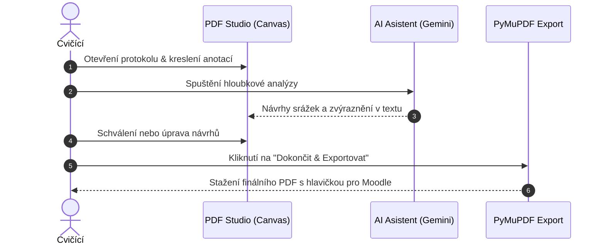

# Rychlý start

Tento průvodce vás provede základním pracovním postupem od nahrání protokolu až po export opraveného souboru s bodovým hodnocením.

---

## 1. Přihlášení do aplikace

Po spuštění aplikace otevřete webový prohlížeč na adrese `http://localhost:8000`.

- Výchozí účet administrátora:
    - **Uživatel:** `admin`
    - **Heslo:** `admin`
- Po přihlášení doporučujeme změnit heslo v sekci **Nastavení profilu**.

---

## 2. Nahrání studentských protokolů

1. V horní navigaci klikněte na tlačítko **+ Nahrát protokoly**.
2. Zvolte semestr, termín cvičení a měřenou úlohu.
3. Přetáhněte jeden nebo více PDF souborů do nahrávacího okna.
4. Aplikace automaticky extrahuje jméno studenta z hlavičky PDF souboru a vytvoří záznamy.
5. Nahrané protokoly jsou okamžitě zařazeny do seznamu a připraveny k opravě.

---

## 3. Práce v Korekčním PDF Studiu

Kliknutím na řádek protokolu v tabulce se otevře **Korekční Studio**:

### Anotování textu
- **Zvýraznění textu (Highlighter)**: Vyberte nástroj se symbolem tužky/zvýrazňovače a tažením myši označte text.
- **Vložení poznámky (Sticky Note)**: Klikněte na ikonu bubliny a klikněte na místo v dokumentu. Otevře se editační karta, kde můžete vepsat text komentáře, zvolit barvu a volitelně přiřadit bodovou srážku.
- **Rámečky a šipky**: Pro označení celých tabulek nebo grafů použijte geometrické nástroje.

---

## 4. Spuštění AI Asistenta

1. V pravém horním rohu klikněte na tlačítko **AI Asistent**.
2. V rozbaleném postranním panelu klikněte na **↻ Spustit**.
3. Během několika sekund Gemini provede analýzu:
    - Vypíše celkové shrnutí kvality práce.
    - Zobrazí navržené bodové srážky podle rubriky.
    - Na plátně PDF označí konkrétní problematická místa červeným štítkem.
4. Kliknutím na **✓ Aplikovat** u libovolného návrhu se návrh ihned přenese do oficiálního hodnocení protokolu.

---

## 5. Dokončení a export do Moodle

Po dokončení revize:
1. Zkontrolujte výsledný součet bodů a navrženou známku v plovoucím doku hodnocení.
2. Klikněte na **Kopírovat pro Moodle** – do schránky se zkopíruje formátovaný text s rozpisem bodů a komentáři pro LMS.
3. Klikněte na **✓ Dokončit** – vygeneruje se finální PDF s vizuální hlavičkou a vektorovými anotacemi.
