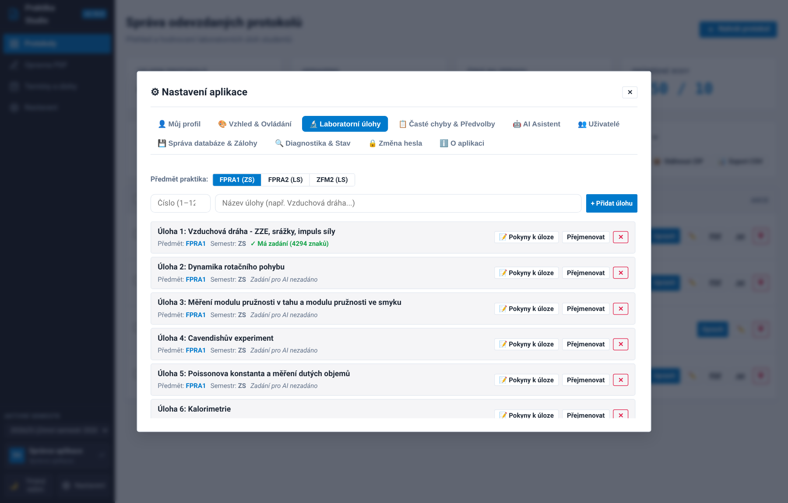
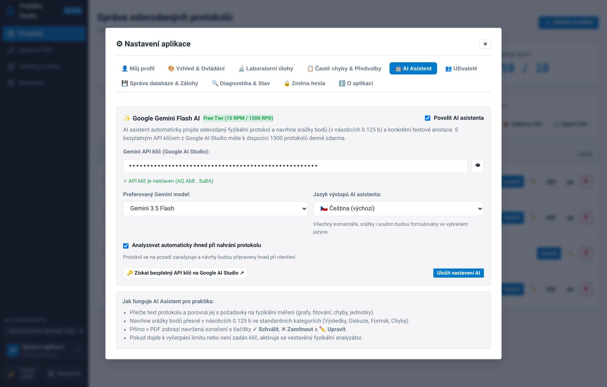
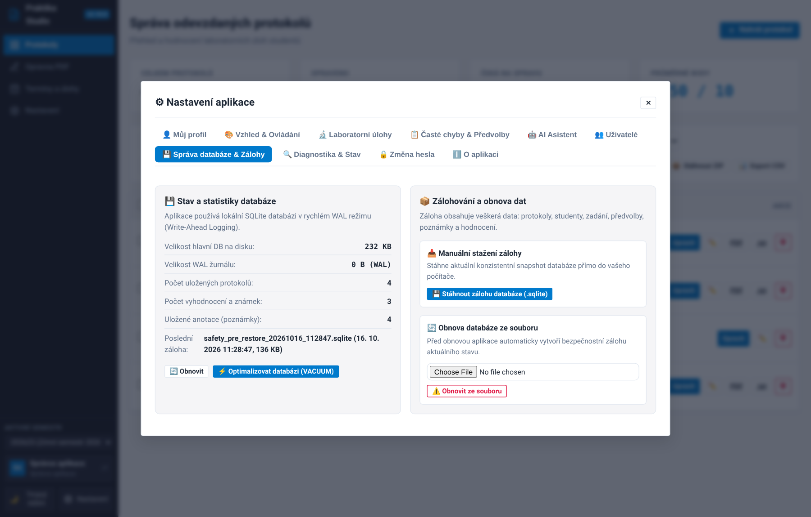

# Příručka pro správce: Administrace a konfigurace systému

Tato příručka je určena pro garanty fyzikálních praktik a správce systému **Praktika Evaluation Studio**. Popisuje konfiguraci semestrů, laboratorních úloh, AI modelů, uživatelských účtů a správu databáze se zálohováním.

---

## 1. Role a oprávnění v systému

Aplikace využívá jednoduché a efektivní řízení přístupových práv (RBAC):

| Funkce / Oprávnění | Asistent (cvičící) | Správce aplikace (admin) |
| :--- | :---: | :---: |
| Oprava přidělených protokolů | ✓ | ✓ |
| Kreslení anotací & schvalování AI návrhů | ✓ | ✓ |
| Export opraveného PDF a Moodle hodnocení | ✓ | ✓ |
| Přístup ke všem protokolům všech skupin | ✕ | ✓ |
| Správa semestrů a rozvrhových termínů | ✕ | ✓ |
| Správa laboratorních úloh a AI rubrik | ✕ | ✓ |
| Konfigurace globálního API klíče a AI modelů | ✕ | ✓ |
| Správa uživatelů a rolí | ✕ | ✓ |
| Správa databáze, optimalizace WAL a zálohování | ✕ | ✓ |
| Systémová diagnostika serveru | ✕ | ✓ |

Správce otevírá administraci kliknutím na ikonu **⚙ Nastavení** v záhlaví aplikace.

---

## 2. Správa semestrů a rozvrhových termínů

V administraci můžete organizovat výuku podle akademických období:

- **Semestry**: Každý semestr má svůj kód (např. `FPRA1_2026ZS`), typ (Zimní semestr / Letní semestr / ZFM) a označení aktivního semestru. Při nahrávání protokolů se výchozí semestr nastaví automaticky.
- **Rozvrhové termíny (sloty)**: Každý termín definuje den v týdnu (např. *Pondělí* až *Pátek*), čas začátku cvičení (např. *8:00*, *10:00*, *14:00*) a volitelný název skupiny či místnosti.
- **Hromadné filtrování a export**: Na řídicím panelu lze filtrovat protokoly podle termínů nebo stáhnout hromadný ZIP archiv všech opravených PDF včetně souhrnného souboru `bodovani.txt`.

---

## 3. Laboratorní úlohy a AI syntéza hodnoticích rubrik

V záložce **🔬 Laboratorní úlohy** může správce konfigurovat katalog úloh:

### Automatická AI syntéza hodnoticího manuálu
Pro každou laboratorní úlohu lze nahrát oficiální univerzitní zadání (PDF návod):

1. U vybrané úlohy klikněte na **Nahrát návod k úloze**.
2. Systém z PDF návodu extrahuje text a předá jej modelu Google Gemini.
3. Gemini provede syntézu a vytvoří strukturovanou **Hodnoticí rubriku úlohy**:
   - *Cíl a princip úlohy* (co přesně má student naměřit a stanovit).
   - *Povinné výstupy* (vyžadované tabulky, grafy a fity).
   - *Výpočty a nejistoty* (statistické nejistoty typu A, nejistoty typu B z dělení měřidel).
   - *Kritické body a časté chyby* (správné zaokrouhlování na 1–2 platné cifry, diskuze systematických chyb aparatury).
4. Tato rubrika slouží asistentům jako přehledný návod a současně je automaticky injektována do promptu AI Asistenta při hodnocení protokolů z této úlohy.

---

## 4. Konfigurace AI Asistenta (Google Gemini)

V záložce **🤖 AI Asistent** správce nastavuje parametry umělé inteligence:

### Parametry konfigurace:
- **Gemini API klíč**: Klíč z [Google AI Studio](https://aistudio.google.com/app/apikey). S bezplatným tarifem (Free Tier) máte k dispozici 15 požadavků za minutu a až 1500 protokolů denně zdarma. Klíč je bezpečně uložen v lokální databázi.
- **Preferovaný Gemini model**:
  - `gemini-3.5-flash-lite` *(Doporučeno)*: Vynikající rychlost, minimální latence a vysoká spolehlivost.
  - `gemini-flash-lite-latest`: Vždy nejnovější verze odlehčeného modelu.
  - `gemini-3.8-flash`: Zvýšená kapacita pro komplexní fyzikální úvahy.
  - `Vlastní název modelu`: Možnost zadat libovolný model z rodiny Google Gemini.
- **Jazyk výstupů AI asistenta**:
  - `🇨🇿 Čeština` *(výchozí)*: Všechny komentáře, srážky i souhrn budou generovány spisovnou češtinou.
  - `🇸🇰 Slovenčina`: Výstupy budou generovány ve slovenštině.
  - `🇬🇧 English`: Výstupy budou generovány v angličtině.
  - `🌐 Automaticky podle protokolu`: Jazyk se přizpůsobí jazyku odevzdaného dokumentu (vhodné pro smíšené česko-slovenské studijní skupiny).
- **Automatická analýza při nahrání**: Pokud je zaškrtnuto, nově nahrané protokoly se okamžitě na pozadí analyzují, takže asistent má návrhy připravené ihned při prvním otevření protokolu.

---

## 5. Správa uživatelských účtů

V záložce **👥 Uživatelé** správce spravuje účty vyučujících a cvičících:

- **Vytvoření nového uživatele**: Zadejte přihlašovací login, celé jméno včetně akademických titulů a počáteční heslo.
- **Přiřazení role**: Zvolte buď `Asistent`, nebo `Správce aplikace`.
- **Zobrazované jméno**: Celé jméno s tituly se automaticky používá jako autor všech poznámek v PDF a v záhlaví opraveného protokolu (*"Hodnotil: Ing. Petr Svoboda, Ph.D."*).

---

## 6. Správa databáze & Automatické zálohy

V záložce **💾 Správa databáze & Zálohy** má správce plnou kontrolu nad datovou vrstvou:

### SQLite WAL Architektura
Aplikace využívá transakční SQLite databázi v režimu **WAL (Write-Ahead Logging)**:
- Čtenáři neblokují zapisovatele a zapisovatelé neblokují čtenáře, což zajišťuje okamžitou odezvu i při souběžné práci více asistentů.
- Správce vidí v reálném čase velikost hlavní databáze na disku, velikost WAL žurnálu i počet uložených protokolů a anotací.

### Optimalizace databáze (VACUUM)
Kliknutím na tlačítko **⚡ Optimalizovat databázi (VACUUM)** dojde k:
1. Vyprázdnění a přepsání WAL žurnálu do hlavní databáze (`wal_checkpoint(TRUNCATE)`).
2. Spuštění defragmentace a uvolnění nepoužitého místa na disku (`VACUUM`).
3. Optimalizaci indexů pro maximální rychlost dotazů.

### Zálohování a obnova dat
- **Manuální snapshot**: Kliknutím na **📥 Stáhnout zálohu** se vytvoří konzistentní záložní kopie databáze přímo ke stažení do vašeho počítače.
- **Automatické týdenní zálohy**: Systém automaticky vytváří snapshoty do adresáře `data/backups/`. Udržuje se rotace posledních 10 verzí, nejstarší zálohy se automaticky odmazávají.
- **Obnova ze zálohy**: Přetažením záložního souboru `.sqlite3` do nahrávacího pole můžete systém kdykoliv obnovit do předchozího stavu.

---

## 7. Diagnostika a stav serveru

V záložce **🔍 Diagnostika & Stav** jsou dostupné metriky provozu serveru:
- Verze aplikace (v souladu s `app/version.py`).
- Stav paměti RAM a volného místa na disku.
- Výsledky testu integrity databáze (`PRAGMA integrity_check`).
- Stav připojení k síti a dostupnost Gemini API endpointů.
