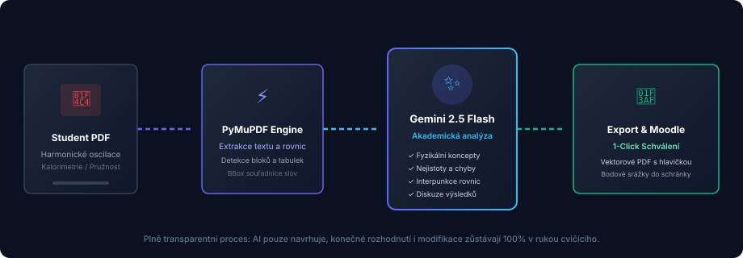

# AI Asistent (Google Gemini)

AI Asistent v aplikaci Praktika slouží jako inteligentní pomocník vyučujícího, který urychluje kontrolu rutinních chyb, formátování a teoretických nedostatků.

---

## 🧠 Použitý jazykový model

Aplikace využívá **Google Gemini 2.5 Flash** (s automatickou fallback strategií na `gemini-1.5-flash` nebo `gemini-1.5-pro` v případě nedostupnosti či překročení limitů).

- Model disponuje velkým kontextovým oknem schopným pojmout celý studentský protokol včetně vzorců a tabulek.
- Systémový prompt je striktně kalibrován na **české univerzitní standardy fyzikálních praktik** (metrologie ČSN EN ISO, pravidla sazby matematických textů, značení nejistot měření).

---

## 🔍 Co AI asistent kontroluje

AI asistent se soustředí výhradně na věcné a formální chyby:

1. **Typografie a formát**:
   - Chybějící interpunkční čárky za rovnicemi (*„, kde...“*).
   - Neoznačené nebo nečíslované tabulky a grafy.
   - Nekonzistentní jednotky veličin (např. míchání cm a m bez převodu).
2. **Výsledky a metrologie**:
   - Absence chyb typu A, typu B nebo kombinované nejistoty.
   - Nesprávné zaokrouhlování na platné číslice (nejistota na 1–2 platné číslice, hodnota zaokrouhlena na stejný řád).
3. **Diskuze a závěr**:
   - Zda diskuze neobsahuje pouhé opakování postupu měření.
   - Srovnání s tabulkovou nebo referenční hodnotou.
   - Identifikace vlivu okolní teploty, tření či odporu vzduchu.

> [!IMPORTANT]
> AI asistent nevytváří prázdná konstatování o tom, co je správně. Veškeré návrhy jsou zaměřeny na identifikaci konkrétních nedostatků k nápravě.

---

## 🖱 Práce s návrhy na plátně a v panelu

Návrhy vygenerované asistentem se zobrazují na dvou místech současně:

1. **V postranním panelu AI Asistenta**:
   - Shrnutí celkového dojmu z protokolu.
   - Seznam navržených srážek s tlačítky **✓ Přidat** a **✕ Zahodit**.
   - Seznam konkrétních textových výtek s číslem stránky. Kliknutím na položku se plátno PDF automaticky posune na dané místo.
2. **Přímo na stránce PDF (In-Canvas)**:
   - Problematické místo je ohraničeno červeným rámečkem s plovoucím štítkem.
   - Štítek obsahuje tlačítka **✓ Aplikovat** a **✕ Zahodit**.
   - Kliknutím na **✓ Aplikovat** se návrh okamžitě převede na standardní cvičitelské zvýraznění s komentářem a zmizí z obou seznamů.

---

## 🔑 Nastavení API klíče

- Administrátor může nastavit globální klíč `GEMINI_API_KEY` v prostředí serveru nebo v konfiguračním souboru `.env`.
- Každý vyučující si navíc může v **Nastavení profilu** zadat svůj vlastní privátní Gemini API klíč, který má přednost před systémovým.
