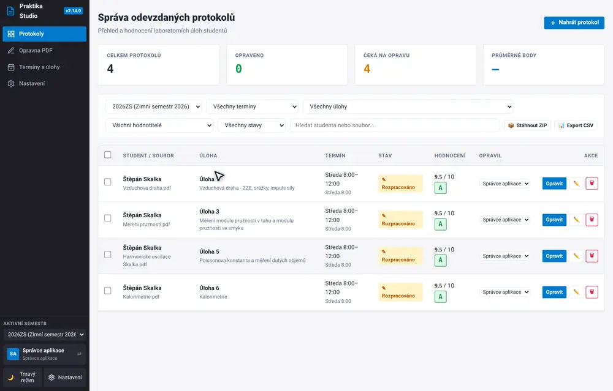
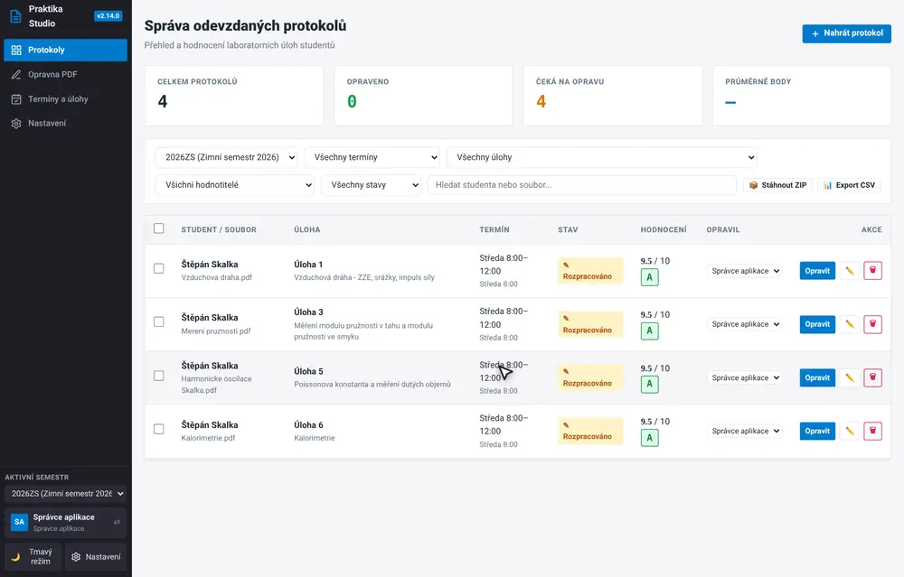
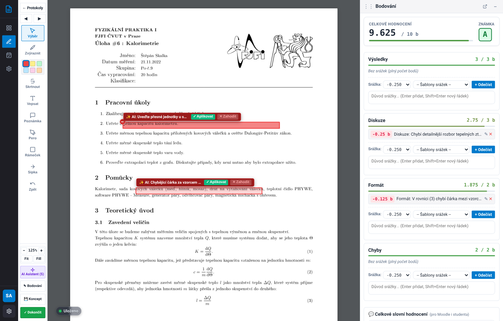
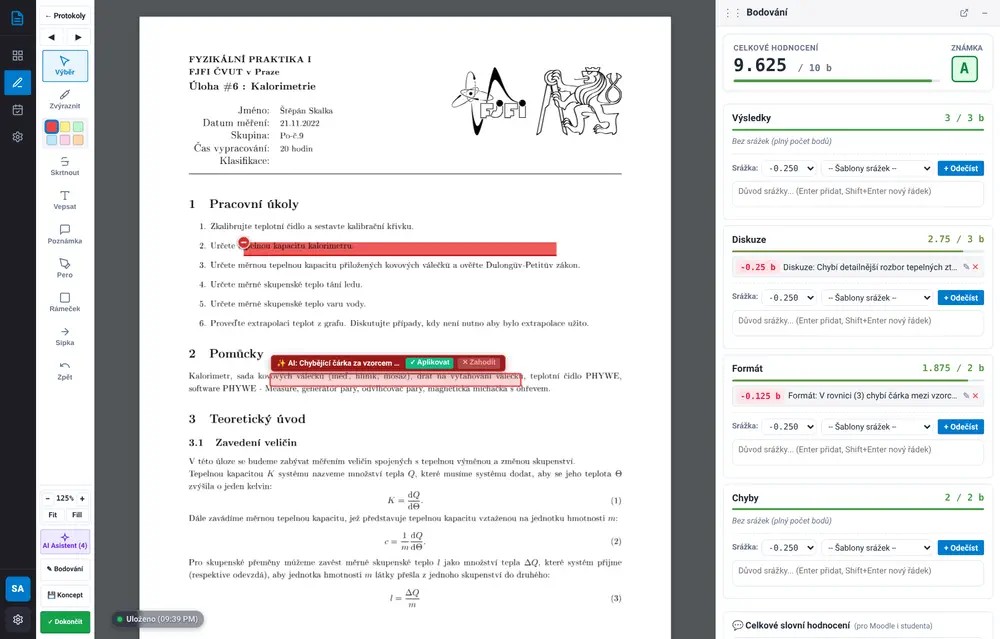
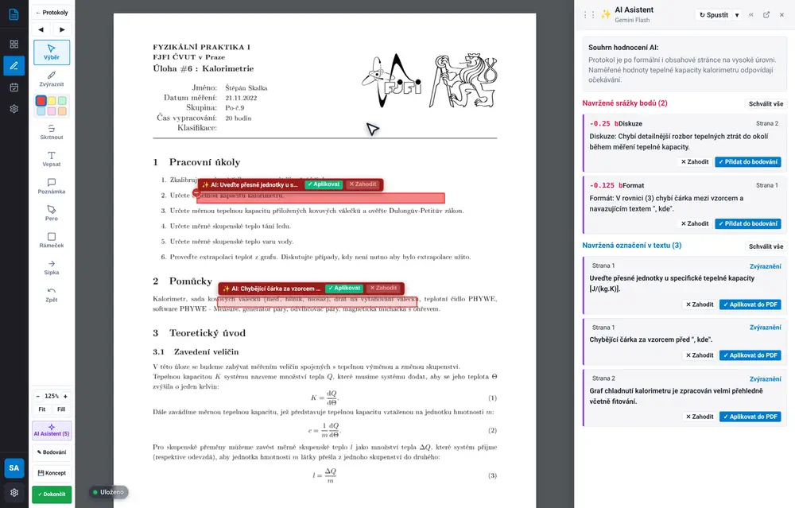
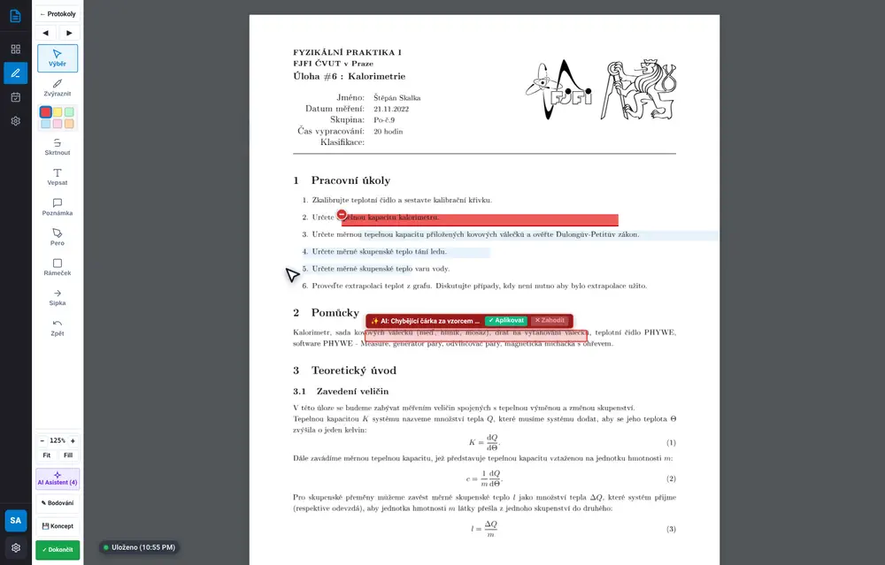

# Příručka pro asistenty: Průvodce opravou protokolů

Tento průvodce vás krok za krokem provede hodnocením a opravou studentských laboratorních protokolů v **Praktika Evaluation Studio v2.14.0**. Cílem aplikace je ušetřit vám čas při rutinních činnostech (přepisování bodů, formátování srážek pro Moodle) a umožnit vám soustředit se na věcnou a pedagogickou zpětnou vazbu pro studenta.

---

## 1. Import protokolů a automatická detekce

Nový protokol nahrajete na hlavní stránce tlačítkem **+ Nahrát protokol**:

- **Hromadný výběr**: Můžete přetáhnout i více PDF souborů najednou.
- **Inteligentní autodetekce**: Aplikace automaticky přečte text první strany PDF a sama předvyplní jméno studenta, název i číslo laboratorní úlohy a rozvrhový termín.
- Nemusíte složitě vyplňovat formulář – stačí zkontrolovat detekované údaje a potvrdit import.

---

## 2. Hromadné operace a správa protokolů

V tabulkovém přehledu na hlavní stránce můžete snadno spravovat větší množství protokolů současně:

- **Hromadný výběr (Multi-select)**: Zaškrtnutím políček v levém sloupci tabulky vyberete libovolné protokoly. V záhlaví tabulky je k dispozici hromadné zaškrtávátko pro celou zobrazenou skupinu.
- **Plovoucí akční panel**: Po označení protokolů se v dolní části obrazovky vysune akční panel:
  - **Hromadná úprava**: Změna cvičícího (asistenta), stavu hodnocení (např. *Rozpracováno* / *Opraveno*) nebo přesun do jiného rozvrhového termínu pro celou skupinu studentů najednou.
  - **Hromadné smazání**: Bezpečné hromadné odstranění vybraných protokolů s potvrzovacím dialogem a ochranou proti nechtěnému smazání.

---

## 3. Pracovní plocha Korekčního PDF Studia

Kliknutím na tlačítko **Opravit** nebo přímo na řádek studenta v tabulce se otevře Studio:

### Způsoby zoomování a navigace
- **Plynulý zoom touchpadem (Pinch-to-zoom)**: Přirozené zvětšování dvěma prsty se samostatně kalibrovanou citlivostí.
- **Kolečko myši s klávesou Ctrl (`Ctrl + Scroll`)**: Rychlé krokové přibližování centrované na pozici kurzoru.
- **Tlačítka v nástrojové liště**: K dispozici jsou tlačítka `+`, `−`, reset na `100 %` a přizpůsobení na celou šířku obrazovky (`Na šířku`).
- **Celoobrazovkový režim (`⛶`)**: Tlačítko vpravo nahoře maximalizuje okno na celý monitor.
- **Přizpůsobení bočních doků**: Šířku panelů AI Asistenta i Bodovacího doku můžete jednoduše měnit tažením za jejich levý okraj.

---

## 4. Celkový průběh opravy (Video ukázka)

Následující animace zachycuje reálnou práci asistenta od prohlížení protokolu přes kreslení, schválení AI návrhu až po zadání bodů:

---

## 5. Anotace a kreslení v PDF

Horní nástrojová lišta poskytuje standardní nástroje kompatibilní s Adobe Acrobat:

| Ikona | Nástroj | Klávesa | Jak nástroj používat |
| :---: | :--- | :---: | :--- |
| ✋ | **Ruka / Výběr** | `H` | Posun dokumentu (pan) a kliknutím výběr nakreslených objektů k přesunu či smazání. |
| 🖍️ | **Zvýrazňovač** | `U` | Označení textu tažením myši. Po puštění lze dopsat vysvětlující komentář. |
| <s>S</s> | **Přeškrtnutí** | `S` | Vodorovné přeškrtnutí chybného výrazu či vzorce. |
| ✏️ | **Kreslení perem** | `P` | Plynulá kaligrafická kresba (fajfky, otazníky, zakroužkování chyb). |
| 💬 | **Poznámka** | `N` | Umístění samolepicí poznámky (speech bubble) s rozklikávacím komentářem. |
| 🔲 | **Obdélník** | `R` | Rámeček s jemnou průhlednou výplní pro označení grafu, tabulky nebo odstavce. |
| ↗ | **Šipka** | `A` | Směrová šipka mířící na konkrétní číselnou či formální chybu. |
| **T** | **Přímý text** | `T` | Vepsání textového hodnocení přímo do plochy PDF (psací stroj). |

### Výběr a manipulace s objekty
- Chcete-li libovolný nakreslený tvar (obdélník, šipku, kresbu perem) posunout, přepněte na nástroj **Ruka / Výběr** (`H`) a na tvar klikněte.
- Kolem tvaru se zobrazí manipulační rámeček. Tvar lze chytit myší a přetáhnout na jiné místo.
- Pro smazání stiskněte klávesu **`Delete`** / **`Backspace`**, nebo klikněte na červenou ikonu koše v rohu rámečku.
- Volba barvy v liště ovlivňuje pouze nově kreslené prvky; již nakreslené anotace se zpětně nepřebarvují.

---

## 6. Práce s AI Asistentem (Google Gemini)

AI Asistent vám poslouží jako druhý pár očí. Přečte celý protokol a připraví návrhy věcných, formálních i syntaktických nedostatků:

### Jak pracovat s návrhy
1. Otevřete boční panel kliknutím na tlačítko **AI Asistent** v pravém horním rohu.
2. V přehledu vidíte stručné shrnutí kvality protokolu a seznam nalezených nedostatků.
3. Kliknutím na libovolnou položku v panelu se PDF okamžitě posune přímo na dané místo.
4. **Schválení návrhu**: Klikněte na **✓ Aplikovat do PDF** (buď v bočním panelu, nebo přímo na plátně u zvýrazněného textu). Návrh se okamžitě převede na vaši oficiální anotaci.
5. **Zamítnutí návrhu**: Kliknutím na **✕ Zahodit** návrh odstraníte, pokud jej nepovažujete za relevantní.

---

## 7. Bodovací dok a Celkové slovní hodnocení

Bodování je rozděleno do čtyř standardních kategorií odpovídajících pravidlům fyzikálního praktika:

- **Hodnoticí kategorie**:
  - *Výsledky & Grafy* (max. 3.0 b)
  - *Diskuze & Závěr* (max. 3.0 b)
  - *Formát & Úprava* (max. 2.0 b)
  - *Chyby měření & Nejistoty* (max. 2.0 b)
- **Rychlé šablony srážek**: Z rozbalovací nabídky můžete jedním kliknutím vybrat časté chyby (např. *-0.25 b: chybějící čárka před ", kde"*). Srážky jsou počítány v přesných násobcích **0.125 b**.
- **Celkové slovní hodnocení**: Do textového pole napište shrnující komentář o tom, jak protokol hodnotíte jako celek. Tento komentář se automaticky propíše:
  - do textového výstupu pro Moodle,
  - do samolepicí Acrobat poznámky na 1. straně PDF,
  - do závěrečné souhrnné přílohy (Appendix),
  - do webového studentského náhledu.
- **Automatická známka ECTS**: Známka A až F se počítá v reálném čase podle součtu bodů. Kliknutím na známku v záhlaví doku ji můžete v případě potřeby ručně upravit.

---

## 8. Uložení, dokončení a export PDF

> [!IMPORTANT]
> **Vždy nejprve uložte koncept před stažením PDF:**
> Před exportem PDF vždy klikněte na tlačítko **💾 Koncept** (`Ctrl+S`) nebo přímo na zelené tlačítko **✓ Dokončit** (`Ctrl+Enter`). Tím se provede uložení všech vrstev anotací do databáze a vygeneruje se aktuální opravené PDF. Pokud byste soubor stahovali ze záložek bez uložení, soubor by neobsahoval vaše poslední provedené změny.

### Výstupy hodnocení:
1. **📋 Kopírovat pro Moodle**: Tlačítko v bodovacím doku zkopíruje do schránky kompletní formátovaný text s body, srážkami a celkovým slovním hodnocením pro vložení do poznámky k hodnocení v LMS Moodle.
2. **✓ Dokončit**: Označí protokol jako opravený a vygeneruje finální PDF:
   - **Ostré pravoúhlé zvýraznění**: Všechna zvýraznění mají dokonale ostré hrany, pevnou spodní linku a interaktivní tooltip s komentářem při najetí myší v Adobe Acrobat, Google Chrome i Brave.
   - **Moodle samolepicí poznámka na 1. straně**: V záhlaví první strany je vložena Acrobat poznámka obsahující kompletní rozpis srážek a slovní hodnocení.
   - **Plynulá perokresba**: Kresby perem jsou automaticky vyhlazeny Chaikinovým algoritmem.
   - **Závěrečná příloha (Appendix)**: Přehledná tabulka všech srážek a karet komentářů s obousměrnými odkazy (`[1]`, `[2]`, ...).
   - **QR kód & Studentský náhled**: QR kód na 1. straně odkazuje na interaktivní webové zobrazení.

---

## 9. Interaktivní studentský náhled a Tmavý režim (`/v/{share_token}`)

Po naskenování QR kódu nebo otevření vygenerovaného zabezpečeného odkazu se studentovi otevře moderní webový náhled:

- **Živé vykreslovací jádro (Studio Engine)**: Student vidí přesně totéž rozhraní jako asistent během hodnocení. Prohlížeč načítá čisté zdrojové PDF a dynamicky nad ním vykresluje interaktivní SVG vrstvu anotací (ostrá pravoúhlá zvýraznění se spodní linkou, ikonky komentářů `[⊖]`, plynulé perokresby, šipky a psací stroj).
- **Interaktivní bubliny (Hover Tooltips)**: Při najetí myší na libovolné zvýraznění nebo ikonu v textu se okamžitě zobrazí bublina s celým komentářem asistenta a jeho jménem.
- **Obousměrná navigace**: Kliknutí na jakoukoliv položku v seznamu poznámek v pravém sloupci plynule odscrolluje PDF na příslušné místo a vizuálně zvýrazní danou anotaci pulzním rámečkem.
- **Plnohodnotný Tmavý režim (Dark Mode)**: Tlačítko `🌙 Tmavý režim` v záhlaví přepíná mezi světlým a nočním režimem šetřícím zrak. Zvolený režim se ukládá do paměti prohlížeče.
- **Přepnutí na exportované PDF**: V horní liště má student možnost kliknout na `📄 Exportované PDF` a zobrazit pre-renderovanou verzi s vepsanými poznámkami a závěrečnou přílohou (Appendix), nebo si kompletní opravené PDF přímo stáhnout do počítače tlačítkem **Stáhnout PDF**.
