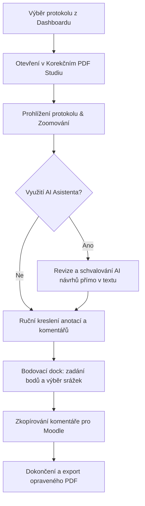
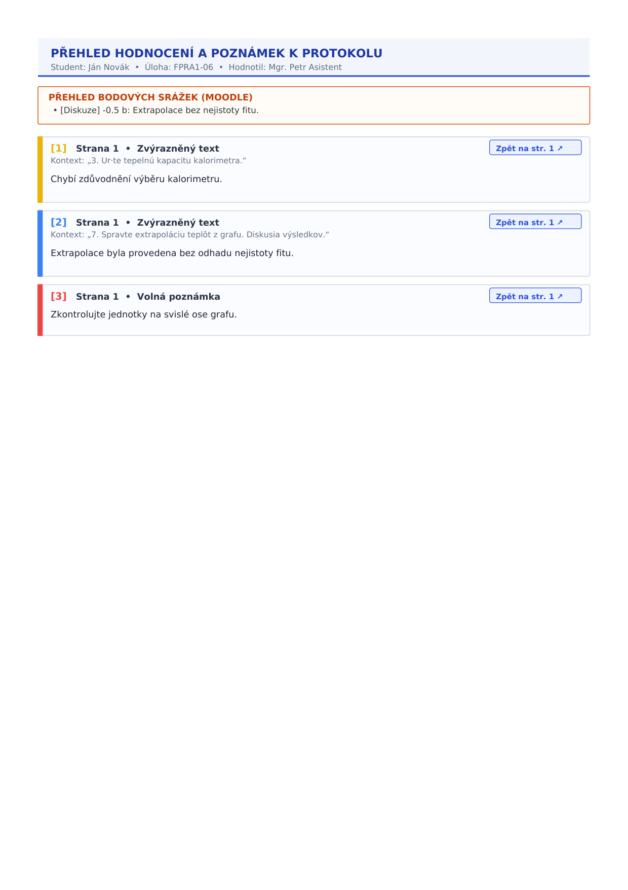

# Příručka pro asistenty: Workflow opravy protokolů

Tato příručka detailně popisuje každodenní práci asistenta (cvičícího) při hodnocení a opravě laboratorních protokolů v **Praktika Evaluation Studio**.

---

## 1. Celkový přehled procesu opravy

Práce asistenta probíhá v plně integrovaném grafickém prostředí, kde se kombinují manuální anotační nástroje, asistence umělé inteligence a automatizované bodování s exportem do Moodle:

---

## 2. Pracovní plocha Korekčního PDF Studia

Kliknutím na tlačítko **Opravit** nebo řádek protokolu na hlavní stránce se otevře Studio:

### Ovládání zobrazení a zoomu
- **Plynulý zoom touchpadem (Pinch-to-zoom)**: Přirozené plynulé zvětšování a zmenšování se samostatně kalibrovanou citlivostí.
- **Kolečko myši s Ctrl (`Ctrl + Scroll`)**: Krokový zoom v přesných 8% intervalech centrovaný na pozici kurzoru.
- **Tlačítka zoomu**: V horní liště jsou k dispozici tlačítka `+`, `-`, reset na `100 %` a automatické přizpůsobení na šířku okna (`Na šířku`).
- **Celoobrazovkový režim (Fullscreen)**: Tlačítko `⛶` maximalizuje studio pro ničím nerušenou práci na celém monitoru.
- **Roztahování bočních panelů**: Okraje obou bočních doků (AI Asistent i Bodování) lze jednoduše uchopit kurzorem myši a tažením přizpůsobit jejich šířku velikosti vaší obrazovky.

---

## 3. Animační ukázka práce ve Studiu

Následující animace zachycuje reálné používání anotačních nástrojů, výběru nakreslených objektů, schvalování AI návrhů a zadávání srážek bodů:

<picture>
  <source srcset="../assets/images/studio_workflow.webp" type="image/webp">
  
</picture>

---

## 4. Anotační nástroje (Acrobat-standard)

Nástrojová lišta v horní části nabízí paletu nástrojů plně kompatibilních se standardem Adobe Acrobat:

| Ikona | Nástroj | Klávesa | Popis použití |
| :---: | :--- | :---: | :--- |
| ✋ | **Ruka / Výběr** | `H` | Posun dokumentu (pan) a výběr/přesouvání nakreslených objektů. |
| 🖍️ | **Zvýrazňovač** | `U` | Označení řádků textu. Kliknutím na zvýraznění lze dopsat textový komentář. |
| <s>S</s> | **Přeškrtnutí** | `S` | Vodorovné přeškrtnutí nesprávného textu či vzorce. |
| ✏️ | **Kreslení perem** | `P` | Volná kresba od ruky (např. zakroužkování, fajfka, vlnovka). |
| 💬 | **Poznámka** | `N` | Vložení samolepicí poznámky (Acrobat speech bubble ikona) s rozbalovacím komentářem. |
| 🔲 | **Obdélník** | `R` | Ohraničení grafu, tabulky nebo odstavce s jemnou barevnou výplní. |
| ↗ | **Šipka** | `A` | Směrová šipka s plným hrotem ukazující na konkrétní chybu. |
| **T** | **Přímý text** | `T` | Vepsání textového hodnocení přímo do plochy dokumentu (psací stroj). |

### Výběr barvy
Před použitím libovolného nástroje můžete zvolit barvu z palety (červená, modrá, zelená, oranžová, fialová). Volba barvy ovlivňuje pouze nově vytvářené anotace a nikdy zpětně nepřebarvuje existující prvky.

---

## 5. Výběr, přesouvání a mazání nakreslených tvarů

Aplikace podporuje plnou manipulaci se všemi nakreslenými objekty (obdélníky, šipky, perokresby, textové poznámky):

1. **Aktivace výběru**: Přepněte se na nástroj **Ruka / Výběr** (klávesa `H`) a klikněte na libovolný tvar na plátně.
2. **Manipulační rámeček**: Kolem vybraného objektu se zobrazí ohraničující rámeček se 4 manipulačními body v rozích a červenou ikonou koše.
3. **Přesouvání**: Uchopte vybraný tvar myší a libovolně jej přetáhněte na nové místo na stránce.
4. **Smazání**: 
   - Stiskněte klávesu **`Delete`** nebo **`Backspace`** na klávesnici.
   - Nebo klikněte na červenou **ikonu koše** v pravém horním rohu výběrového rámečku.

---

## 6. Práce s AI Asistentem (Gemini)

AI Asistent automaticky projde odevzdaný protokol a připraví detailní návrhy korektur i bodových srážek:

### Zobrazení a orientace v návrzích
- Kliknutím na tlačítko **AI Asistent** v pravém horním rohu otevřete boční panel.
- V horní části je přehledné textové shrnutí hlavních nedostatků protokolu.
- V sekci **Navržená označení v textu** vidíte seznam nalezených chyb s číslem strany a přesným textem.
- **Kliknutí na libovolnou položku** v panelu okamžitě posune stránku a vystředí dané místo na obrazovce.

### Schvalování a zamítání přímo v textu PDF
Každé navržené problematické místo v textu protokolu je zvýrazněno a opatřeno interaktivním panelem se třemi akcemi:

- **✓ Schválit**: Okamžitě převede AI návrh na vaši oficiální anotaci v PDF, odstraní návrhový box a promítne změnu do systému.
- **✕ Zamítnout**: Návrh ihned smaže z dokumentu i ze seznamu návrhů.
- **✏️ Upravit**: Otevře editační okno komentáře, kde můžete upravit formulaci nebo přiřadit konkrétní bodovou srážku.

> [!NOTE]
> Schválené i zamítnuté návrhy se okamžitě ukládají do databáze. Stav korektur zůstává zachován i při zavření a opětovném otevření protokolu.

### Opakované spuštění analýzy
V hlavičce AI panelu máte dvě možnosti opětovného spuštění:
1. **+ Přidat nové návrhy (Merge)**: Ponechá všechny dosud schválené či existující návrhy a doplní pouze nově objevené chyby.
2. **↻ Kompletně nahradit (Replace)**: Vyčistí stávající neschválené návrhy a vygeneruje kompletně novou analýzu od začátku.

---

## 7. Bodovací dock a srážky bodů

Hodnocení protokolu se provádí v praktickém doku, který lze mít přikotvený vpravo/vlevo nebo volně plovoucí:

- **Čtyři hodnoticí kategorie**:
  - *Výsledky* (0.0 až 3.0 b)
  - *Diskuze* (0.0 až 3.0 b)
  - *Formát* (0.0 až 2.0 b)
  - *Chyby* (0.0 až 2.0 b)
- **Katalog častých chyb**: Kliknutím na předvolbu (např. *-0.25 b: chybějící čárka před ", kde"*) se srážka ihned aplikuje a promítne do součtu. Všechny srážky jsou striktně v násobcích **0.125 b**.
- **Výsledná známka**: Aplikace automaticky počítá známku ECTS (A–F) podle celkového součtu:
  - **A**: 9.00 až 10.00 b
  - **B**: 8.00 až 8.875 b
  - **C**: 6.00 až 7.875 b
  - **D**: 4.00 až 5.875 b
  - **E**: 2.00 až 3.875 b
  - **F**: pod 2.00 b (nevyhověl)

---

## 8. Export opraveného protokolu a text pro Moodle

Jakmile je protokol zkontrolován:

1. **Zkopírování pro Moodle**: Klikněte na tlačítko **📋 Kopírovat pro Moodle**. Do schránky se zkopíruje strukturovaný text s celkovým hodnocením, dílčími body a odrážkovým seznamem všech bodových srážek, připravený k vložení do odevzdávárny LMS Moodle.
2. **Dokončení a PDF Export**: Klikněte na zelené tlačítko **✓ Dokončit**.
   - Vygeneruje se finální opravené PDF s vizuální hodnoticí hlavičkou na 1. straně a souhrnnou přílohou na konci dokumentu:

### Co obsahuje exportované PDF:
- **Kompaktní hodnoticí záhlaví s QR kódem**: Výrazná známka, celkový počet bodů z 10 b, rozpis dílčích kategorií, jméno cvičícího, datum exportu a QR kód s klikacím odkazem pro studenta.
- **Acrobat Moodle komentář**: V pravém horním rohu záhlaví je umístěna nativní samolepicí poznámka, která po otevření v libovolném PDF prohlížeči (Adobe Acrobat, Chrome, Brave, Preview) obsahuje kompletní rozpis srážek bodů připravený k překopírování do IS/Moodle.
- **Ostré pravoúhlé zvýraznění textu**: Zvýraznění má dokonale ostré rohy a pevnou spodní linku na účaří textu, přesně jako v aplikaci.
- **Jednotné ikony volných poznámek**: Každá poznámka má jednu čistou ikonu doplněnou o indexový štítek `[1]`, `[2]`, ...
- **Plynule vyhlazená perokresba**: Volné tahy perem jsou automaticky vyhlazovány Chaikinovým algoritmem pro přirozený kaligrafický vzhled.
- **Závěrečná příloha (Přehled hodnocení a poznámek)**: Na konci PDF je generován přehled všech poznámek s kontextovými výňatky textu, rozpisem srážek a obousměrnými klikacími odkazy (`[1]` v textu přeskočí na kartu v příloze; tlačítko `Zpět na str. X ↗` vrátí čtenáře na příslušnou stranu):

- **Zabezpečený studentský náhled (`/v/{share_token}`)**: Po naskenování QR kódu nebo kliknutí na odkaz se studentovi otevře responzivní webové zobrazení hodnocení bez nutnosti přihlášení.
- **Plná podpora české i slovenské diakritiky**: Znaky jako `ě`, `š`, `č`, `ř`, `ž`, `ť`, `ľ` se zobrazují bez jakéhokoliv poškození v libovolném čtenáři PDF díky UTF-16BE podpoře.
