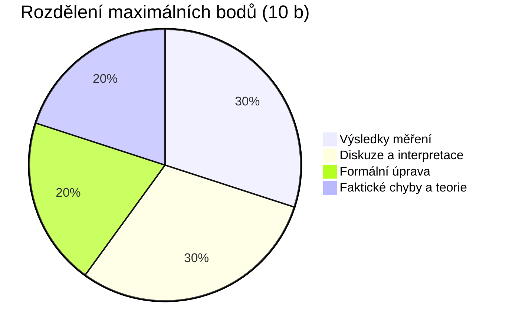

# Bodování a export pro Moodle

Hodnocení laboratorních protokolů v aplikaci Praktika je navrženo tak, aby bylo plně transparentní, objektivní a přímočaré pro přenos do univerzitního systému Moodle.

---

## ⚖️ Hodnotící rubrika

Celkové hodnocení protokolu se skládá ze čtyř samostatných kategorií s maximálním součtem **10.0 bodů**:



1. **Výsledky (max. 3.0 b)**:
   - Správnost naměřených a vypočtených hodnot.
   - Výpočet nejistot měření (typu A, typu B, kombinovaná a rozšířená nejistota).
   - Zaokrouhlení výsledků a správné fyzikální jednotky.
2. **Diskuze (max. 3.0 b)**:
   - Hloubka fyzikální interpretace naměřených jevů.
   - Porovnání s tabulkovými hodnotami nebo teoretickým modelem.
   - Identifikace a rozbor hlavních zdrojů systematických chyb.
3. **Formát (max. 2.0 b)**:
   - Typografie, sazba matematických vzorců v LaTeXu.
   - Interpunkce za rovnicemi (*„, kde...“*).
   - Popisky os grafů, tabulek a citace literatury.
4. **Chyby a teorie (max. 2.0 b)**:
   - Správnost teoretického úvodu a odvození vztahů.
   - Odpovědi na kontrolní teoretické otázky k měření.

---

## 📉 Systém bodových srážek (Deductions)

Místo abstraktního zadávání čísel umožňuje Praktika odečítat body na základě konkrétních pochybení:

- Srážky lze zadávat v krocích po **0.125 b**, **0.250 b**, **0.500 b**, **0.750 b** nebo **1.000 b**.
- Každá srážka obsahuje:
    - **Kategorii** (*Výsledky, Diskuze, Formát, Chyby*).
    - **Počet stržených bodů** (např. *-0.25 b*).
    - **Konkrétní zdůvodnění** pro studenta.

---

## 🎓 Klasifikační stupnice ECTS

Výsledná známka se kalkuluje automaticky z celkového bodového zisku:

| Celkem bodů | Známka | Slovní hodnocení |
|---|---|---|
| **9.00 – 10.00 b** | **A** | Výborně |
| **8.00 – 8.99 b** | **B** | Velmi dobře |
| **6.00 – 7.99 b** | **C** | Dobře |
| **4.00 – 5.99 b** | **D** | Uspokojivě |
| **2.00 – 3.99 b** | **E** | Dostatečně |
| **0.00 – 1.99 b** | **F** | Nedostatečně |

> [!NOTE]
> Cvičící má možnost kdykoliv výsledek přepsat pomocí volby **Manuální úprava známky**.

---

## 📋 Export komentáře pro Moodle

Kliknutím na tlačítko **Kopírovat pro Moodle** se do schránky vygeneruje strukturovaný text připravený k vložení do hodnotícího formuláře v Moodle:

```text
Výsledky: 2.50 / 3.0 b
Diskuze: 2.50 / 3.0 b
Formát: 1.75 / 2.0 b
Chyby: 1.75 / 2.0 b
Celkem bodů: 8.50 / 10.0 b | Známka: B

Přehled bodových srážek:
• [Výsledky] -0.50 b: Chybí chyba typu B u měření periody kmitů
• [Formát] -0.25 b: , kde... chybí čárka za rovnicí (1)
• [Diskuze] -0.50 b: Diskuze neobsahuje srovnání s tabulkovou hodnotou g
```

---

## 🖨 Vizuální hlavička v exportovaném PDF

Při exportu protokolu vygeneruje PyMuPDF na první straně reprezentativní kartu hodnocení:


Hlavička obsahuje celkový výsledek, dílčí skóre, jméno cvičícího, datum a seznam konkrétních bodových srážek.
