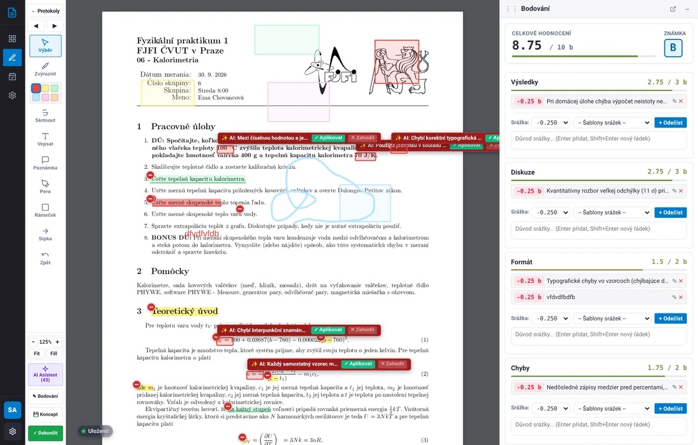
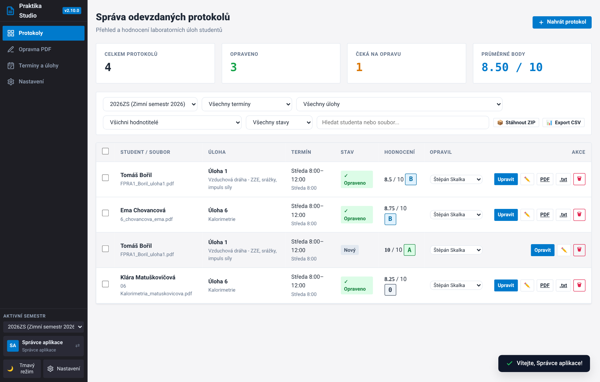
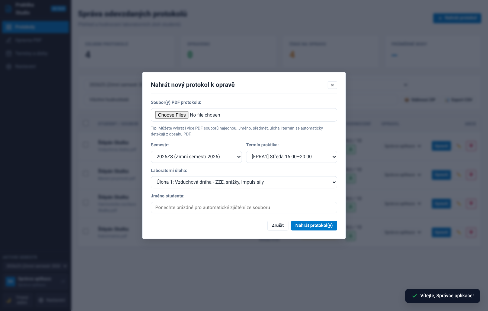
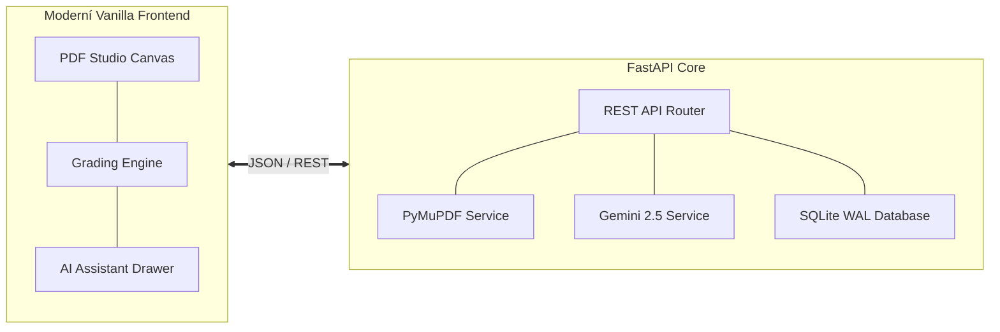

# Praktika – Platforma pro hodnocení laboratorních protokolů

**Praktika** je specializovaná webová aplikace pro vyučující a asistenty fyzikálních praktik, určená k efektivní, konzistentní a detailní opravě studentských laboratorních protokolů ve formátu PDF.

Systém integruje rychlé grafické anotační plátno s vektorovými kreslícími nástroji (zvýrazňovač, pero, geometrické tvary, šipky a textové poznámky), strukturované bodovací rubriky a analytického asistenta využívajícího modely **Google Gemini**.



---

## 🎯 Klíčové schopnosti

=== "PDF Studio"
    - **Acrobat-kompatibilní plátno**: Plynulé vektorové vykreslování anotací s plnou obousměrnou kompatibilitou se standardem Adobe Acrobat a formátem PDF.
    - **Dostupné anotační nástroje**:
        - **Zvýraznění textu** (`U`) s volitelnou paletou barev a připojeným textovým komentářem
        - **Přeškrtnutí textu** (`S`) pro přímou indikaci chyb ve vzorcích a větách
        - **Přímý vepsaný text** (`T`) s nastavitelnou velikostí a barvou písma
        - **Volné kreslení perem** (`P`) s automatickým vyhlazováním křivek
        - **Ohraničující obdélníky** (`R`) s nastavitelným obrysem a průsvitnou výplní
        - **Směrové šipky** (`A`) s ostrými hroty pro přesnou navigaci na konkrétní chybu
        - **Poznámkové bubliny** (`N`) pro bodové komentáře
    - **Výběr, posun a mazání**: Nástroj Výběr (`V` / `H`) umožňuje označit libovolnou přidanou anotaci, posunout ji myší po plátně nebo smazat (`Delete` / `Backspace`).

=== "Bodování & Moodle"
    - **Čtyři hodnotící pilíře**: Výsledky (max 3 b), Diskuze (max 3 b), Formát (max 2 b) a Chyby měření (max 2 b).
    - **Katalog srážek**: Rychlé odečítání bodů v násobcích **0.125 b** s předvolenými i vlastními odůvodněními.
    - **Celkové slovní hodnocení**: Souhrnný komentář o celkovém dojmu z protokolu automaticky propagovaný do Moodle i studentovi.
    - **Automatický výpočet známky**: Převod na škálu ECTS (A–F) s možností manuálního přepsání.
    - **Moodle export**: Okamžité vygenerování textového komentáře pro vložení do univerzitního LMS jedním kliknutím.

=== "AI Asistent (Gemini)"
    - **Hloubková fyzikální kontrola**: Detekce typografie rovnic (*", kde"*), nejistot měření, errorbarů v grafech a kvality diskuze.
    - **Návrhy přímo v textu**: AI navrhuje srážky a vytváří v textu zvýrazněná místa se štítkem a tlačítky pro okamžité schválení (✓) či zamítnutí (✕).
    - **Multijazyčnost**: Volba cílového jazyka výstupů (čeština, slovenština, angličtina nebo auto podle protokolu).
    - **100% kontrola cvičícího**: Žádná změna se neaplikuje automaticky bez explicitního schválení vyučujícím.

=== "Studentský náhled"
    - **Webový náhled protokolu**: Okamžitý přístup pro studenta přes unikátní odkaz či QR kód bez nutnosti přihlášení.
    - **Živé vykreslovací jádro**: Prohlížeč studenta načítá čistý protokol s dynamickou SVG vrstvou anotací identickou s rozhraním asistenta.
    - **Interaktivní poznámky a tooltipy**: Najetí na zvýrazněný text zobrazí bublinu s komentářem; v bočním panelu jsou přehledně seřazené všechny poznámky s možností prokliku přímo na danou stranu.
    - **Plynulý zoom**: Nezávislý zoom izolovaný výhradně na PDF dokument (Ctrl + Scroll, touchpad pinch gesta) bez nechtěného zvětšování celého okna prohlížeče.
    - **Plná mobilní responzivita**: Na telefonech a tabletech segmentovaný přepínač záložek mezi PDF protokolem a souhrnným hodnocením.

---

## 🚀 Rychlý start

### 1. Přihlášení do aplikace

Po spuštění aplikace (lokálně nebo v Docker kontejneru) otevřete webový prohlížeč na adrese:

```
http://localhost:8000
```

Při prvním spuštění se zobrazí přihlašovací okno. Výchozí účet hlavního správce aplikace má tyto přihlašovací údaje:

| Položka | Hodnota |
| :--- | :--- |
| **Uživatelské jméno** | `admin` |
| **Výchozí heslo** | `admin123` |
| **Role** | Správce aplikace (admin) |

> [!TIP]
> Po prvním přihlášení doporučujeme změnit výchozí heslo v záložce **⚙ Nastavení -> 🔒 Změna hesla**.

---

### 2. Hlavní přehled (Dashboard)

Po přihlášení se zobrazí hlavní řídicí panel aplikace:



Na řídicím panelu máte k dispozici:
- **Přepínač semestrů**: Umožňuje přepínat mezi aktuálním a minulými semestry (např. *ZS 2026/2027*).
- **Informativní statistické karty**: Okamžitý přehled celkového počtu odevzdaných prací, rozpracovaných konceptů, dokončených protokolů a průměrné známky.
- **Rychlý filtr a vyhledávání**: Filtrování podle konkrétní laboratorní úlohy, rozvrhového termínu, cvičícího nebo stavu.

---

### 3. Nahrání studentských protokolů

1. V horní nástrojové liště klikněte na tlačítko **+ Nahrát protokoly**.
2. Otevře se dialog pro nahrání souborů:



3. Zvolte semestr, termín cvičení (např. *Středa 8:00*) a laboratorní úlohu.
4. Přetáhněte jeden nebo více PDF souborů do vyznačené zóny.
5. Systém automaticky analyzuje text v hlavičce PDF a extrahuje jméno studenta.
6. Klikněte na **Nahrát protokol(y)**. Pokud je v nastavení povolen AI asistent s volbou automatické analýzy, protokol se ihned na pozadí připraví k vyhodnocení.

---

### 4. Výběr příručky podle vaší role

Aplikace rozlišuje specifické potřeby asistentů (cvičících) a správců systému:

<div class="grid cards" markdown>

-   :material-account-edit:{ .lg .middle } __[Příručka pro asistenty](guide/assistant.md)__

    ---

    Kompletní průvodce opravou protokolu:
    - Práce s kreslicími a anotačními nástroji
    - Výběr, přesouvání a mazání geometrických tvarů
    - Práce s návrhy AI asistenta a jejich schvalování v textu
    - Bodovací dock, katalogy častých chyb a export pro Moodle

    [:octicons-arrow-right-24: Přejít na příručku pro asistenty](guide/assistant.md)

-   :material-shield-crown:{ .lg .middle } __[Příručka pro správce](guide/admin.md)__

    ---

    Správa a konfigurace celého systému:
    - Správa semestrů a rozvrhových termínů
    - Správa laboratorních úloh a AI syntéza hodnoticích rubrik
    - Konfigurace Gemini AI modelů a jazyka výstupů
    - Uživatelské účty a správa SQLite databáze & zálohy

    [:octicons-arrow-right-24: Přejít na příručku pro správce](guide/admin.md)

</div>

---

## 📐 Architektura ve zkratce



---

## 📖 Další kapitoly dokumentace

1. Nahlédněte do **[Příručky pro asistenty](guide/assistant.md)** pro kompletní průvodce opravou protokolu.
2. Projděte si **[Příručku pro správce](guide/admin.md)** pro správu úloh, AI modelů a zálohování databáze.
3. Pro nasazení na server pomocí Dockeru využijte průvodce **[Instalace přes Docker & Portainer](installation/docker.md)**.
