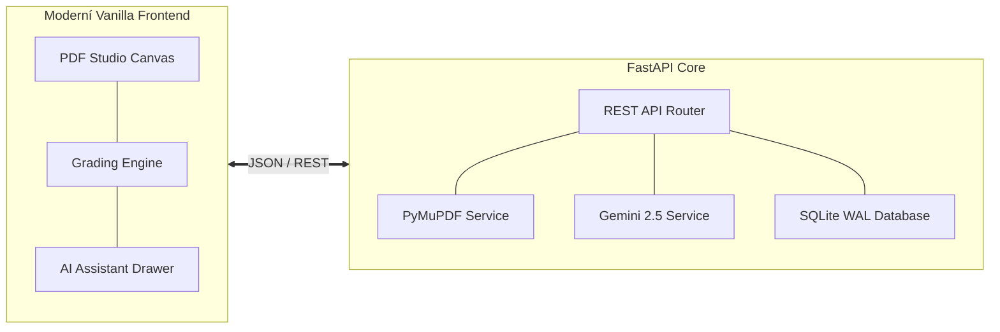

# Praktika – Platforma pro hodnocení laboratorních protokolů

**Praktika** je specializovaná webová aplikace pro vyučující a asistenty fyzikálních praktik, určená k efektivní, konzistentní a detailní opravě studentských laboratorních protokolů ve formátu PDF.

Systém integruje rychlé grafické anotační plátno s vektorovými kreslícími nástroji (zvýrazňovač, pero, geometrické tvary, šipky a textové poznámky), strukturované bodovací rubriky a analytického asistenta využívajícího model **Google Gemini 2.5 Flash**.

---

## 🎯 Klíčové schopnosti

=== "Korekční PDF Studio"
    - **Acrobat-kompatibilní plátno**: Plynulé vektorové vykreslování s podporou libovolného rozlišení a DPI.
    - **Anotační nástroje**: Zvýraznění textu, přeškrtnutí, přímý vepsaný text, volné kreslení perem, ohraničující obdélníky a směrové šipky.
    - **Barevné palety per-prvek**: Výběr barvy při editaci komentářů, synchronizovaná polo-průhledná výplň geometrických tvarů.
    - **Plovoucí automatické ukládání**: Nenápadná fixní indikace v rohu obrazovky zajišťuje kontinuální perzistenci bez zmenšení pracovního prostoru.

=== "Bodování & Moodle"
    - **Čtyři hodnotící pilíře**: Výsledky (max 3 b), Diskuze (max 3 b), Formát (max 2 b) a Chyby (max 2 b).
    - **Katalog srážek**: Rychlé odečítání bodů s předvolenými i vlastními odůvodněními (např. *-0.25 b: chybějící čárka za rovnicí*).
    - **Automatický výpočet známky**: Převod na škálu ECTS (A–F) s možností manuálního přepsání.
    - **Moodle export**: Okamžité vygenerování textového komentáře pro vložení do univerzitního LMS jedním kliknutím.

=== "AI Asistent (Gemini)"
    - **Fyzikálně zaměřená kontrola**: Analýza textu, matematických vztahů, nejistot měření a kvality diskuze.
    - **Návrhy přímo v textu**: AI navrhuje srážky a vytváří v textu zvýrazněná místa se štítkem a tlačítkem pro schválení.
    - **100% kontrola cvičícího**: Žádná změna se neaplikuje automaticky bez explicitního schválení vyučujícím.

---

## 📐 Architektura ve zkratce

---

## 🚀 Jak začít

1. Přečtěte si **[Rychlý start](getting-started.md)** pro seznámení se základním workflow.
2. Nahlédněte do **[Uživatelské příručky](guide/ui-overview.md)** pro detailní popis všech funkcí.
3. Pro nasazení na server pomocí Dockeru využijte průvodce **[Instalace přes Docker & Portainer](installation/docker.md)**.
