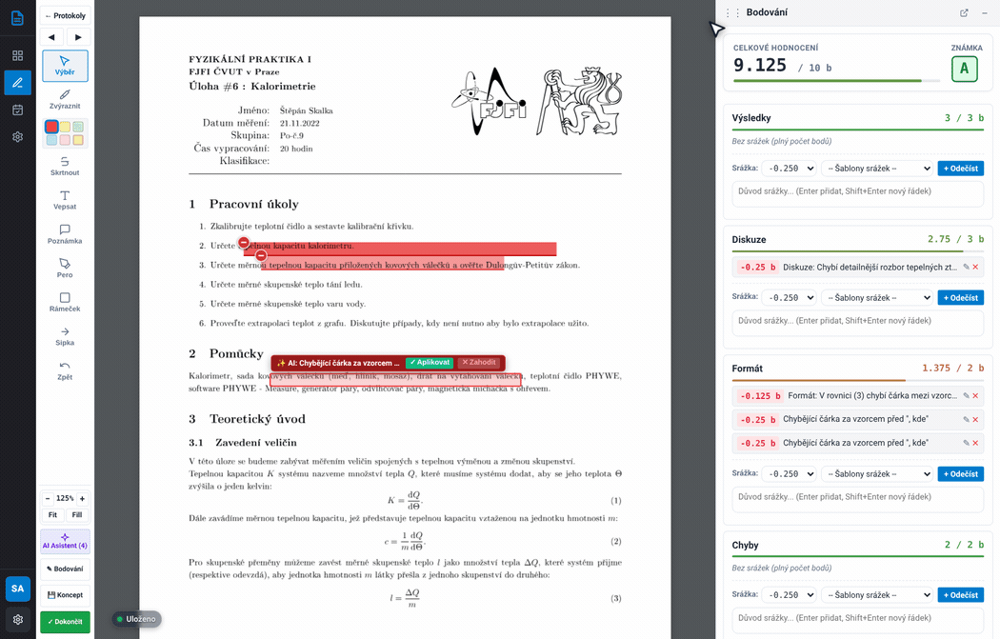
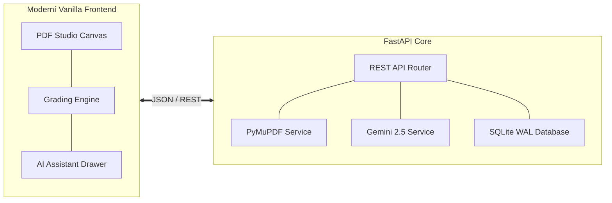

# Praktika – Platforma pro hodnocení laboratorních protokolů

**Praktika** je specializovaná webová aplikace pro vyučující a asistenty fyzikálních praktik, určená k efektivní, konzistentní a detailní opravě studentských laboratorních protokolů ve formátu PDF.

Systém integruje rychlé grafické anotační plátno s vektorovými kreslícími nástroji (zvýrazňovač, pero, geometrické tvary, šipky a textové poznámky), strukturované bodovací rubriky a analytického asistenta využívajícího model **Google Gemini 2.5 Flash**.

<picture>
  <source srcset="assets/images/studio_workflow.webp" type="image/webp">
  
</picture>

---

## 🎯 Klíčové schopnosti

=== "Korekční PDF Studio"
    - **Acrobat-kompatibilní plátno**: Plynulé vektorové vykreslování s podporou libovolného rozlišení a DPI.
    - **Anotační nástroje**: Zvýraznění textu, přeškrtnutí, přímý vepsaný text, volné kreslení perem, ohraničující obdélníky a směrové šipky.
    - **Výběr, přesouvání a mazání**: Manipulační rámeček u všech tvarů s rohovými body, tažením myší a mazáním klávesou `Delete` / `Backspace` či ikonou koše.
    - **Plynulý zoom**: Touchpad pinch-to-zoom a `Ctrl + Scroll` kolečkem myši s nezávislou citlivostí v uživatelském nastavení.
    - **Plovoucí automatické ukládání**: Nenápadná fixní indikace v rohu obrazovky zajišťuje kontinuální perzistenci bez zmenšení pracovního prostoru.

=== "Bodování & Moodle"
    - **Čtyři hodnotící pilíře**: Výsledky (max 3 b), Diskuze (max 3 b), Formát (max 2 b) a Chyby (max 2 b).
    - **Katalog srážek**: Rychlé odečítání bodů v násobcích **0.125 b** s předvolenými i vlastními odůvodněními.
    - **Automatický výpočet známky**: Převod na škálu ECTS (A–F) s možností manuálního přepsání.
    - **Moodle export**: Okamžité vygenerování textového komentáře pro vložení do univerzitního LMS jedním kliknutím.

=== "AI Asistent (Gemini)"
    - **Hloubková fyzikální kontrola**: Detekce typografie rovnic (*", kde"*), nejistot měření, errorbarů v grafech a kvality diskuze.
    - **Návrhy přímo v textu**: AI navrhuje srážky a vytváří v textu zvýrazněná místa se štítkem a tlačítky pro okamžité schválení (✓) či zamítnutí (✕).
    - **Multijazyčnost**: Volba cílového jazyka výstupů (čeština, slovenština, angličtina nebo auto podle protokolu).
    - **100% kontrola cvičícího**: Žádná změna se neaplikuje automaticky bez explicitního schválení vyučujícím.

---

## 📐 Architektura ve zkratce

---

## 🚀 Jak začít

1. Přečtěte si **[Rychlý start](getting-started.md)** pro seznámení se základním workflow a přihlašovacími údaji.
2. Nahlédněte do **[Příručky pro asistenty](guide/assistant.md)** pro kompletní průvodce opravou protokolu.
3. Projděte si **[Příručku pro správce](guide/admin.md)** pro správu úloh, AI modelů a zálohování databáze.
4. Pro nasazení na server pomocí Dockeru využijte průvodce **[Instalace přes Docker & Portainer](installation/docker.md)**.
